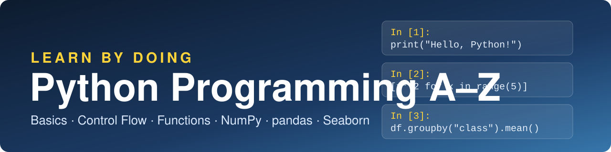

<p align="center">
  <a href="https://www.python.org/"></a>
  <a href="https://jupyter.org/"></a>
  <a href="https://numpy.org/"></a>
  <a href="https://pandas.pydata.org/"></a>
  <a href="https://matplotlib.org/"></a>
  <a href="https://seaborn.pydata.org/"></a>
  <a href=".github/workflows/notebooks-check.yml"></a>
  
  
</p>

A hands-on Python course in **46 Jupyter notebooks**, from your first variable to NumPy, pandas and Seaborn. Every topic follows the same loop: a **concept** notebook, **exercise questions**, then **solutions**, so you can try first and check after.

> *"Learn the language by writing it: 46 notebooks, 1,162 code cells, 8,568 lines of annotated Python."*

---

## Course map

| # | Section | Notebooks | What you work on |
|:-:|---------|:---------:|------------------|
| 00 | [Quickstart](00-quickstart/) 🎯 | 3 | Course overview script and two intro notebooks |
| 01 | [Python Basics](01-python-basics/) 🏗 | 20 | Variables, strings, lists, dicts, tuples, sets |
| 02 | [Control Flow & Functions](02-control-flow-and-functions/) 🔄 | 22 | Conditionals, loops, comprehensions, functions, files |
| 03 | [Data Science Toolkit](03-data-science/) 📊 | 4 | NumPy, pandas, Matplotlib, Seaborn |

---

## Learning path

```
 Quickstart ──► Python Basics ──► Control Flow & Functions ──► Data Science Toolkit
   (00)           variables          if / elif / else            NumPy   arrays
                  strings            for / while / range         pandas  DataFrames
                  lists              comprehensions              Matplotlib
                  dicts              functions, lambda           Seaborn
                  tuples, sets       map, filter, files
```

Each section builds on the previous one: the lists and dictionaries from Section 1 are what loops and functions work on in Section 2, and the files you learn to read there lead straight into pandas in Section 3.

---

## Notebook tour

<details>
<summary>🏗 <b>Section 1 — Python Basics</b> (20 notebooks)</summary>

| Notebook | Topic |
|---|---|
| [`1a-variables-and-math-concept.ipynb`](01-python-basics/1a-variables-and-math-concept.ipynb) | Variables, assignment, precedence and basic math |
| [`1b-variables-and-math-exercise-questions.ipynb`](01-python-basics/1b-variables-and-math-exercise-questions.ipynb) | Exercise: variables and math (questions) |
| [`1c-variables-and-math-exercise-practice.ipynb`](01-python-basics/1c-variables-and-math-exercise-practice.ipynb) | Exercise: variables and math (my practice attempt) |
| [`2a-print-and-input-concept.ipynb`](01-python-basics/2a-print-and-input-concept.ipynb) | `print()` and getting user input |
| [`2b-print-and-input-exercise-questions.ipynb`](01-python-basics/2b-print-and-input-exercise-questions.ipynb) | Exercise: print and input (questions) |
| [`2b-print-and-input-exercise-practice.ipynb`](01-python-basics/2b-print-and-input-exercise-practice.ipynb) | Exercise: print and input (my practice attempt) |
| [`2c-print-and-input-exercise-solutions.ipynb`](01-python-basics/2c-print-and-input-exercise-solutions.ipynb) | Solutions: print and input |
| [`2c-print-and-input-exercise-solutions-extended.ipynb`](01-python-basics/2c-print-and-input-exercise-solutions-extended.ipynb) | Solutions: print and input, extended with error handling and comments |
| [`3a-strings-concept.ipynb`](01-python-basics/3a-strings-concept.ipynb) | Strings and string methods |
| [`3b-strings-exercise-questions.ipynb`](01-python-basics/3b-strings-exercise-questions.ipynb) | Exercise: strings (questions) |
| [`3c-strings-exercise-solutions.ipynb`](01-python-basics/3c-strings-exercise-solutions.ipynb) | Solutions: strings |
| [`4a-lists-concept.ipynb`](01-python-basics/4a-lists-concept.ipynb) | Lists |
| [`4b-lists-exercise-questions.ipynb`](01-python-basics/4b-lists-exercise-questions.ipynb) | Exercise: lists (questions) |
| [`4c-lists-exercise-solutions.ipynb`](01-python-basics/4c-lists-exercise-solutions.ipynb) | Solutions: lists |
| [`5a-dictionaries-and-booleans-concept.ipynb`](01-python-basics/5a-dictionaries-and-booleans-concept.ipynb) | Dictionaries and booleans |
| [`5b-dictionaries-and-booleans-exercise-questions.ipynb`](01-python-basics/5b-dictionaries-and-booleans-exercise-questions.ipynb) | Exercise: dictionaries and booleans (questions) |
| [`5c-dictionaries-and-booleans-exercise-solutions.ipynb`](01-python-basics/5c-dictionaries-and-booleans-exercise-solutions.ipynb) | Solutions: dictionaries and booleans |
| [`6a-tuples-and-sets-concept.ipynb`](01-python-basics/6a-tuples-and-sets-concept.ipynb) | Tuples and sets |
| [`6b-tuples-and-sets-exercise-questions.ipynb`](01-python-basics/6b-tuples-and-sets-exercise-questions.ipynb) | Exercise: tuples and sets (questions) |
| [`6c-tuples-and-sets-exercise-solutions.ipynb`](01-python-basics/6c-tuples-and-sets-exercise-solutions.ipynb) | Solutions: tuples and sets |

</details>

<details>
<summary>🔄 <b>Section 2 — Control Flow & Functions</b> (22 notebooks)</summary>

| Notebook | Topic |
|---|---|
| [`01-conditionals-concepts.ipynb`](02-control-flow-and-functions/01-conditionals-concepts.ipynb) | Comparison and logical operators, `if` / `elif` / `else` |
| [`02-conditionals-exercise-questions.ipynb`](02-control-flow-and-functions/02-conditionals-exercise-questions.ipynb) | Exercise: conditionals (questions) |
| [`03-conditionals-exercise-solutions.ipynb`](02-control-flow-and-functions/03-conditionals-exercise-solutions.ipynb) | Solutions: conditionals |
| [`04-for-loops.ipynb`](02-control-flow-and-functions/04-for-loops.ipynb) | `for` loops |
| [`05-range.ipynb`](02-control-flow-and-functions/05-range.ipynb) | `range()` |
| [`06-while-loop.ipynb`](02-control-flow-and-functions/06-while-loop.ipynb) | `while` loops |
| [`07-nested-loops.ipynb`](02-control-flow-and-functions/07-nested-loops.ipynb) | Nested loops |
| [`08-break-a-loop.ipynb`](02-control-flow-and-functions/08-break-a-loop.ipynb) | `break` and `continue` |
| [`09-loops-exercise-questions.ipynb`](02-control-flow-and-functions/09-loops-exercise-questions.ipynb) | Exercise: `for` and `while` loops (questions) |
| [`10-loops-exercise-solutions.ipynb`](02-control-flow-and-functions/10-loops-exercise-solutions.ipynb) | Solutions: `for` and `while` loops |
| [`11-list-comprehensions.ipynb`](02-control-flow-and-functions/11-list-comprehensions.ipynb) | List comprehensions |
| [`12-functions.ipynb`](02-control-flow-and-functions/12-functions.ipynb) | Defining and calling functions |
| [`13-built-in-functions.ipynb`](02-control-flow-and-functions/13-built-in-functions.ipynb) | Built-in functions |
| [`14-lambda-expressions.ipynb`](02-control-flow-and-functions/14-lambda-expressions.ipynb) | `lambda` expressions |
| [`15-map.ipynb`](02-control-flow-and-functions/15-map.ipynb) | `map()` |
| [`16-filter.ipynb`](02-control-flow-and-functions/16-filter.ipynb) | `filter()` |
| [`17-functions-filters-lambda-exercise-questions.ipynb`](02-control-flow-and-functions/17-functions-filters-lambda-exercise-questions.ipynb) | Exercise: functions, filters, lambda (questions) |
| [`18-functions-filters-lambda-exercise-solutions.ipynb`](02-control-flow-and-functions/18-functions-filters-lambda-exercise-solutions.ipynb) | Solutions: functions, filters, lambda |
| [`19-text-files.ipynb`](02-control-flow-and-functions/19-text-files.ipynb) | Reading and writing text files |
| [`20-csv-files.ipynb`](02-control-flow-and-functions/20-csv-files.ipynb) | Reading and writing CSV files |
| [`21-files-exercise-questions.ipynb`](02-control-flow-and-functions/21-files-exercise-questions.ipynb) | Exercise: file operations (questions) |
| [`22-files-exercise-solutions.ipynb`](02-control-flow-and-functions/22-files-exercise-solutions.ipynb) | Solutions: file operations |

</details>

<details>
<summary>📊 <b>Section 3 — Data Science Toolkit</b> (4 notebooks)</summary>

| Notebook | Topic |
|---|---|
| [`01-numpy.ipynb`](03-data-science/01-numpy.ipynb) | NumPy: arrays and vectorized math |
| [`02-pandas.ipynb`](03-data-science/02-pandas.ipynb) | pandas: Series, DataFrames, reading CSV and HTML data |
| [`03-matplotlib.ipynb`](03-data-science/03-matplotlib.ipynb) | Matplotlib: line, bar, scatter and other charts |
| [`04-seaborn.ipynb`](03-data-science/04-seaborn.ipynb) | Seaborn: pairplot, countplot, scatterplot, Titanic dataset |

</details>

---

## Featured: the data science toolkit

Section 3 applies the basics to real tables and charts.

| Dimension | Detail |
|-----------|--------|
| **Libraries** | NumPy · pandas · Matplotlib · Seaborn (with scikit-learn's breast-cancer dataset and Seaborn's Titanic data) |
| **Concepts** | Arrays → Series and DataFrames → reading CSV / HTML → charts → statistical plots |
| **Notebooks** | [`01-numpy`](03-data-science/01-numpy.ipynb) · [`02-pandas`](03-data-science/02-pandas.ipynb) · [`03-matplotlib`](03-data-science/03-matplotlib.ipynb) · [`04-seaborn`](03-data-science/04-seaborn.ipynb) |

<details>
<summary>📈 Sample from <code>03-data-science/04-seaborn.ipynb</code></summary>

```python
# 🎭 Seaborn Pairplot – Visualizing Feature Relationships
sns.pairplot(df_cancer,
             hue="target",  # 🎨 Color by class (Malignant = Orange, Benign = Blue)
             vars=['mean radius', 'mean texture', 'mean area', 'mean perimeter', 'mean smoothness'],
             palette="coolwarm",  # 🌈 Beautiful color mapping
             markers=["o", "s"],  # 🔵 Use 'o' for benign, 🟠 's' for malignant
             diag_kind="hist")  # 📊 Histograms on diagonal for better readability

# 🏆 Display the plot
plt.show()
```

</details>

---

## Repository layout

```
Python-Programming-A-Z/
├── 00-quickstart/                  # overview script + two intro notebooks
├── 01-python-basics/               # one folder per course section,
├── 02-control-flow-and-functions/  #   each with its own README
├── 03-data-science/
├── assets/                         # README banner
├── .github/                        # CI: notebook validation
└── requirements.txt
```

**Why a single `main`?** This repo used to keep every section on its own branch. Everything now lives on `main`, and the original branch history is preserved in the commit graph.

---

## Quick start

```bash
git clone https://github.com/evgeniimatveev/Python-Programming-A-Z.git
cd Python-Programming-A-Z
uv venv && uv pip install -r requirements.txt   # or: python -m venv .venv && pip install -r requirements.txt
jupyter lab
```

Or skip the setup: every notebook has an **Open in Colab** badge in its section README.

---

## Continuous integration

Every push and pull request runs [`notebooks-check.yml`](.github/workflows/notebooks-check.yml):

| Check | What it catches |
|-------|-----------------|
| **Validate every `.ipynb`** | Broken or corrupted notebook files |
| **Widget metadata** | Notebooks GitHub would show as "Invalid Notebook" |
| **File-name hygiene** | Spaces in file names |
| **Quickstart script** | `00-quickstart/hello_course.py` still runs |

Notebooks are teaching material: CI verifies that they are well-formed, it does not execute them end to end.

---

## Known limitations

- Several notebooks read data files that are **not included** (`canada_house_prices_*.csv`, `sample_file.csv`, the S&P 500 CSV and some text files). They are flagged in the section READMEs.
- `04-seaborn` downloads the Titanic dataset and `02-pandas` reads an HTML table, so both need internet access.
- Notebooks that call `input()` wait for you to type; they are marked with ⌨️ in the section READMEs.
- `22-files-exercise-solutions` still contains absolute paths from the original machine; adjust them before running.
- Saved outputs, including a few intentional error outputs from the exercises, are kept as they were.

---

## Tech stack

`Python` · `Jupyter` · `NumPy` · `pandas` · `Matplotlib` · `Seaborn` · `GitHub Actions`

---

*Built by [Evgenii Matveev](https://github.com/evgeniimatveev) · Data Analyst / Analytics & MLOps Engineer*
